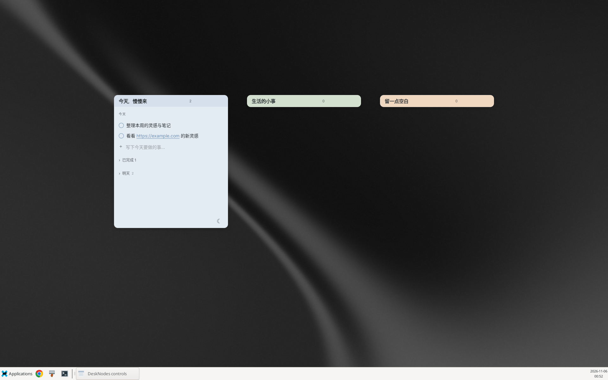
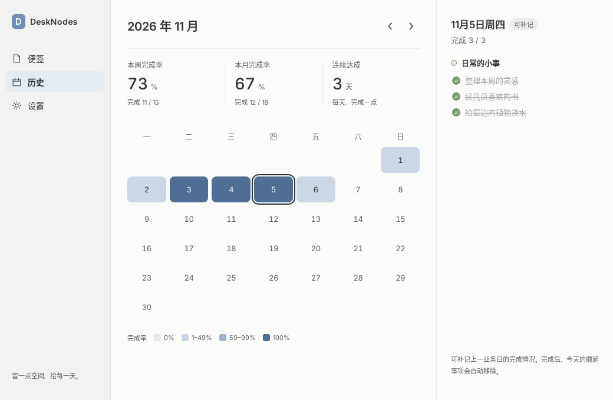
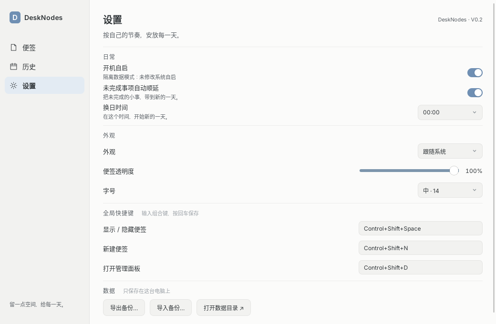
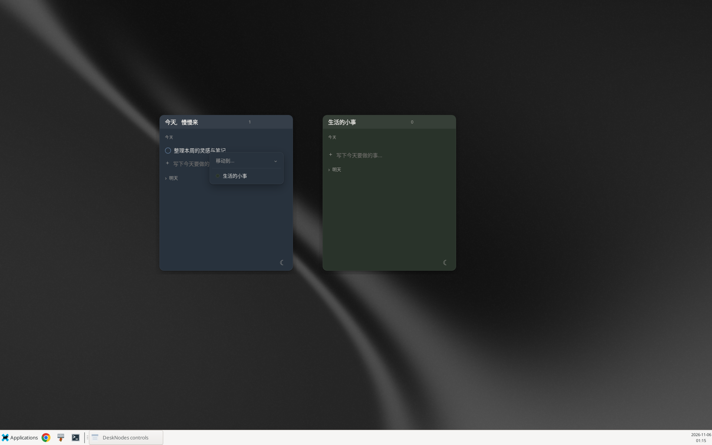

[English](README.md) · [简体中文](README.zh-CN.md)

# DeskNodes

Quiet desktop sticky notes for everyday tasks. DeskNodes V1.0 combines independent, softly colored note windows with local task storage, tomorrow planning, and a calendar of your progress. This README describes source revision `e415d2f`; the npm, Cargo and Tauri packaging version is **1.0.0**.



## V1.0 features

- Independent windows with eight Morandi colors, editable titles, pinning, hiding, dragging and resizing. Positions, sizes, visibility and collapsed state persist; collapse/expand respects reduced motion.
- Today and tomorrow items: add, edit, complete, delete, reorder today's unfinished items by dragging, and move items to another note through the context menu. Delete and move offer a five-second undo. HTTP/HTTPS links open in the system browser.
- Daily rollover at a configurable local hour (00:00–06:00), with optional automatic carry-forward of unfinished tasks and accumulated carry-day badges. Tomorrow's planned items become today's items. The stored business date never moves backward when the clock does.
- A management panel for note visibility and pinning, plus a history calendar with daily details, weekly/monthly completion rates and a consecutive-day streak. The previous business day's completion can be corrected; older days are read-only. Completing a previous-day item removes its unfinished carried copy from today.
- System/light/dark appearance, 70–100% note opacity, three font sizes, configurable global shortcuts, login autostart, JSON backup export/import, and an action to open the data folder.
- Tray actions, fallback native controls, and single-instance handling: launching again opens the management panel. Display changes trigger work-area clamping, helping recover notes from a removed monitor.

Data stays in a local SQLite database; there is no cloud synchronization or account flow. The current application interface is Chinese.

## Screenshots

Existing Linux X11 captures use demonstration data, including a simulated date; they are illustrations rather than a fresh capture of this documentation change.

| History and statistics | Settings |
| --- | --- |
|  |  |



The Settings screen still displays an old **V0.2** label in the current source and capture. Package metadata is **1.0.0**.

## Platform status

| Platform | Verified status |
| --- | --- |
| Debian 13 Linux, x86_64, X11 | Tested; existing validation covers native interaction, deb packaging and extracted AppImage startup. Clean-host installation acceptance remains pending. |
| macOS | Rust cross-target compilation checked only, using Darwin C stubs; no native runtime, DMG acceptance, signing or notarization completed. |
| Windows | Windows GNU Rust cross-target compilation checked only; no native runtime, MSI/NSIS acceptance or signing completed. |

See the [Linux validation record](docs/f10-validation.md) and [release acceptance checklist](docs/f10-release.md). These are historical records, not checks rerun by editing this README. Wayland and physical multi-monitor/mixed-DPI acceptance remain unverified.

## Develop and build

Build on the native OS using the complete `cursor/v1.0-desknodes` branch. The following sections are independent recipes; choose your OS. Commands run from the repository root unless stated otherwise. These instructions do not establish macOS or Windows runtime acceptance; see the platform status above.

The checked-in [.cargo/config.toml](.cargo/config.toml) sets two build jobs and hardcodes `target-dir = "/workspace/desknotes/target"` for the original development environment. That path is **not required on your machine**: each recipe overrides it with an absolute, writable `target` folder in your clone. Repeat the environment assignment in each new terminal before native commands. Paths below assume the native host architecture with no explicit `--target` option.

`npm run dev` starts **only the Vite frontend** on port 1420. `npm run build` runs Svelte/TypeScript checks and builds frontend assets only. Use `npm run tauri dev` for development with native features, or `npm run tauri build -- ...` for a native production build; Tauri invokes the appropriate frontend script automatically. Stop development with Ctrl+C before building or launching another copy.

### macOS (Terminal)

1. Install Git (included with Xcode Command Line Tools) and Apple's desktop build tools, completing the installer dialog:

   ```sh
   xcode-select --install
   ```

2. Install **Node.js 24.x with npm** using the macOS `.pkg` from [official Node.js downloads](https://nodejs.org/en/download) (select version 24 and your CPU architecture). Install Rust via [official rustup](https://rust-lang.org/tools/install/), then select current stable, which supports edition 2024:

   ```sh
   curl --proto '=https' --tlsv1.2 -sSf https://sh.rustup.rs | sh -s -- -y --default-toolchain stable
   . "$HOME/.cargo/env"
   rustup update stable
   rustup default stable
   node --version
   npm --version
   rustc --version
   ```

   Reopen Terminal if Node is not on PATH. See the [official Tauri prerequisites](https://v2.tauri.app/start/prerequisites/#macos). The configured macOS minimum is 10.15; compatibility with the chosen toolchain and system WebView still needs native verification.

3. Clone, install locked dependencies, override Cargo's output directory, and start native development in your logged-in desktop session:

   ```sh
   git clone --branch cursor/v1.0-desknodes --single-branch https://github.com/zlYeYaBuFaYa/desk_nodes.git
   cd desk_nodes
   npm ci
   export CARGO_TARGET_DIR="$PWD/target"
   npm run tauri dev
   ```

4. Choose a production output. For an **executable only**, build and run:

   ```sh
   npm run tauri build -- --no-bundle
   "$CARGO_TARGET_DIR/release/desk-nodes"
   ```

   For an **application bundle and DMG**, explicitly select macOS targets:

   ```sh
   npm run tauri build -- --bundles app,dmg
   open "$CARGO_TARGET_DIR/release/bundle/macos/DeskNodes.app"
   ```

   The app is `target/release/bundle/macos/DeskNodes.app`; disk images are in `target/release/bundle/dmg/`. To install, open the generated `.dmg` in Finder, drag **DeskNodes.app** to **Applications**, eject the image, then launch **DeskNodes** from Applications (or `open /Applications/DeskNodes.app`). Artifact filenames include version and architecture; use the file produced by your build.

   Signing and notarization are not configured or accepted. An unsigned/unnotarized app may be blocked by Gatekeeper; for a build you trust, use macOS **System Settings → Privacy & Security → Open Anyway** when available. Native runtime and DMG installation remain unverified; public distribution requires signing, notarization and native acceptance.

### Windows (PowerShell, native MSVC)

1. Install [Git for Windows](https://git-scm.com/downloads/win). Install [Microsoft C++ Build Tools](https://visualstudio.microsoft.com/visual-cpp-build-tools/) with **Desktop development with C++**, including the MSVC compiler for your architecture and a Windows 10/11 SDK. Ensure [Microsoft Edge WebView2 Runtime](https://developer.microsoft.com/en-us/microsoft-edge/webview2/) is installed; use the Evergreen installer if absent. Follow the [official Tauri Windows prerequisites](https://v2.tauri.app/start/prerequisites/#windows).
2. Install **Node.js 24.x with npm** using the Windows `.msi` from [official Node.js downloads](https://nodejs.org/en/download), selecting version 24 and your architecture. Download and run the matching Windows `rustup-init.exe` from [official Rust downloads](https://rust-lang.org/tools/install/); use the **MSVC** host toolchain. Reopen PowerShell after installation. For **x64 Windows**, select stable MSVC and verify:

   ```powershell
   rustup toolchain install stable-x86_64-pc-windows-msvc
   rustup default stable-x86_64-pc-windows-msvc
   node --version
   npm --version
   rustc -vV
   ```

   The host line must be `x86_64-pc-windows-msvc`. For native ARM64 Windows, install ARM64 C++ build tools and use `stable-aarch64-pc-windows-msvc` instead. Native release builds use MSVC. If PowerShell blocks `npm.ps1`, use `npm.cmd` in place of `npm` in the commands below.

3. Clone and start native development from your Windows desktop session:

   ```powershell
   git clone --branch cursor/v1.0-desknodes --single-branch https://github.com/zlYeYaBuFaYa/desk_nodes.git
   cd desk_nodes
   npm ci
   $env:CARGO_TARGET_DIR = Join-Path $PWD 'target'
   npm run tauri dev
   ```

4. For a production **executable only**, build and launch:

   ```powershell
   npm run tauri build -- --no-bundle
   & (Join-Path $env:CARGO_TARGET_DIR 'release\desk-nodes.exe')
   ```

   This executable requires WebView2 on the destination machine. For **installers**, explicitly select Windows targets:

   ```powershell
   npm run tauri build -- --bundles msi,nsis
   Get-ChildItem (Join-Path $env:CARGO_TARGET_DIR 'release\bundle\msi\*.msi')
   Get-ChildItem (Join-Path $env:CARGO_TARGET_DIR 'release\bundle\nsis\*-setup.exe')
   ```

   MSI files are under `target\release\bundle\msi\`; NSIS setup executables are under `target\release\bundle\nsis\`. Double-click **one** generated `.msi` or `-setup.exe`, complete the installer, then launch **DeskNodes** from the Start menu. Filenames include version, architecture and possibly language; select the actual generated file. Tauri downloads packaging tools as needed, so first-time packaging needs network access. MSI creation also requires the Windows **VBScript** optional feature; see [Tauri's Windows installer guide](https://v2.tauri.app/distribute/windows-installer/). To build only NSIS, use `npm run tauri build -- --bundles nsis`.

   Windows signing is not configured. SmartScreen may warn about an unrecognized publisher or block unsigned builds; only proceed with an artifact you trust under your machine's policy. Native runtime, MSI/NSIS installation, autostart and shortcuts remain unverified.

### Debian 13 Linux (shell)

1. Install the native compiler, GTK 3/WebKitGTK 4.1, tray and packaging dependencies following the [official Tauri Linux prerequisites](https://v2.tauri.app/start/prerequisites/#linux):

   ```sh
   sudo apt update
   sudo apt install git build-essential pkg-config curl wget file libssl-dev libxdo-dev \
     libwebkit2gtk-4.1-dev libgtk-3-dev libayatana-appindicator3-dev librsvg2-dev \
     patchelf xz-utils ca-certificates
   ```

2. Install **Node.js 24.x with npm** from [official Node.js downloads](https://nodejs.org/en/download): select version 24, Linux and your architecture, download the `.tar.xz` binary archive and extract it to a writable location, then add its `bin` directory to PATH (persist that PATH in your shell profile). Do not assume Debian's default `nodejs` package is version 24. For example, if you saved the archive in `~/Downloads`, choose exactly one matching archive:

   ```sh
   mkdir -p "$HOME/.local/lib/nodejs/node24"
   tar -xJf "$HOME/Downloads/node-v24."*-linux-*.tar.xz \
     --strip-components=1 -C "$HOME/.local/lib/nodejs/node24"
   export PATH="$HOME/.local/lib/nodejs/node24/bin:$PATH"
   node --version
   npm --version
   ```

   Install current Rust stable via [official rustup](https://rust-lang.org/tools/install/), supporting edition 2024:

   ```sh
   curl --proto '=https' --tlsv1.2 -sSf https://sh.rustup.rs | sh -s -- -y --default-toolchain stable
   . "$HOME/.cargo/env"
   rustup update stable
   rustup default stable
   rustc --version
   ```

3. Use a logged-in **graphical desktop session**, with its real display and session environment; a headless SSH shell is insufficient for launching the UI. Debian 13 x86_64 X11 is the tested environment; Wayland remains unaccepted. Clone and start:

   ```sh
   git clone --branch cursor/v1.0-desknodes --single-branch https://github.com/zlYeYaBuFaYa/desk_nodes.git
   cd desk_nodes
   npm ci
   export CARGO_TARGET_DIR="$PWD/target"
   npm run tauri dev
   ```

   In an X11 session, `GDK_BACKEND=x11 npm run tauri dev` explicitly selects GTK's X11 backend. If needed, set `DISPLAY` to your actual session display, rather than copying a fixed display number.

4. For a production **executable only**, build and run in the graphical session:

   ```sh
   npm run tauri build -- --no-bundle
   "$CARGO_TARGET_DIR/release/desk-nodes"
   ```

   This executable still needs the system GTK/WebKitGTK and related runtime libraries. For **deb and AppImage packages**, select Linux targets:

   ```sh
   npm run tauri build -- --bundles deb,appimage
   ls "$CARGO_TARGET_DIR/release/bundle/deb/"*.deb
   ls "$CARGO_TARGET_DIR/release/bundle/appimage/"*.AppImage
   ```

   On x86_64 at version 1.0.0, expected paths are `target/release/bundle/deb/DeskNodes_1.0.0_amd64.deb` and `target/release/bundle/appimage/DeskNodes_1.0.0_amd64.AppImage`. Install the deb and launch the installed executable:

   ```sh
   sudo apt install "$CARGO_TARGET_DIR/release/bundle/deb/DeskNodes_1.0.0_amd64.deb"
   desk-nodes
   ```

   Alternatively, run the AppImage without installing the deb:

   ```sh
   chmod +x "$CARGO_TARGET_DIR/release/bundle/appimage/DeskNodes_1.0.0_amd64.AppImage"
   "$CARGO_TARGET_DIR/release/bundle/appimage/DeskNodes_1.0.0_amd64.AppImage"
   ```

   Adjust version/architecture filenames to your actual output. AppImage may require FUSE 2 (`sudo apt install libfuse2t64` on Debian 13). If FUSE is unavailable, extract and launch instead, from a writable directory:

   ```sh
   "$CARGO_TARGET_DIR/release/bundle/appimage/DeskNodes_1.0.0_amd64.AppImage" --appimage-extract
   ./squashfs-root/AppRun
   ```

   Linux packages are unsigned. Existing checks cover deb contents and extracted AppImage startup, but clean-host installation acceptance remains pending. No published release or download service is asserted here.

## Everyday use and shortcuts

The first database starts with one note and three introductory items. Double-click a title to rename it; use the color button for the palette, the pin for always-on-top, minus to hide, and the more menu to collapse or delete. Note deletion is confirmed and soft-deletes the note while preserving its items/history. Deleting the final note is allowed; create another from the management panel or tray, without reseeding examples.

Press Enter to add an item or save an edit; Escape dismisses editing and menus. Delete/Backspace removes a selected today item when focus is outside a text field. Expand “已完成” for completed items or “明天” for tomorrow planning. Right-click an item for “移动到…” (move to another note).

| Global action | Linux / Windows default | macOS default |
| --- | --- | --- |
| Toggle note visibility | Ctrl+Shift+Space | Super (Command)+Shift+Space |
| New note | Ctrl+Shift+N | Super (Command)+Shift+N |
| Open management panel | Ctrl+Shift+D | Super (Command)+Shift+D |

Change bindings in Settings by entering a shortcut and pressing Enter or leaving the field. A failed registration reports an error and preserves the previous binding. Desktop-reserved shortcuts may be unavailable.

Temporary hide-all remembers which notes were visible, so restore preserves individually hidden notes. Recover through tray “显示全部”, the management visibility switches, or the global toggle. Native controls provide a fallback when the tray host is unavailable. Closing a note hides it; use Quit in the tray/control menu to exit. Autostart defaults to enabled; Settings reports integration errors. On Linux it uses `$XDG_CONFIG_HOME/autostart/DeskNodes.desktop`, falling back to `~/.config/autostart/DeskNodes.desktop` when the config variable is absent or not absolute.

History rates divide completed item counts by total item counts, including preserved history from deleted notes and excluding future dates. Weeks run Monday–Sunday. A streak counts consecutive nonempty, fully completed days, anchored on today if complete or yesterday otherwise; a blank or incomplete day breaks it. Week and streak refer to the current business date; month rate follows the displayed month.

## Storage, backups and recovery

| OS | Product data directory |
| --- | --- |
| Linux | `$XDG_DATA_HOME/DeskNodes` when set; otherwise `~/.local/share/DeskNodes` |
| macOS | `~/Library/Application Support/DeskNodes` |
| Windows | `%APPDATA%\DeskNodes` when set; otherwise `%USERPROFILE%\AppData\Roaming\DeskNodes` |

`desknodes.sqlite3` stores notes, dated items and settings in SQLite WAL mode; `-wal` and `-shm` companions may exist. `DESKNODES_DATA_DIR=/absolute/path` overrides the entire product directory, without adding `DeskNodes`. With this override, startup skips system autostart changes; explicitly toggling autostart in Settings still changes the OS integration. Normal startup can migrate the old identifier-based Tauri data directory once, retaining the old files and never replacing an existing destination database.

Automatic snapshots are created **before a due business-day rollover**, including catch-up on launch, under `backups/` inside the data directory. The latest seven complete snapshot directories are retained, with SQLite sidecars when present. This is rollover protection, not continuous version history.

On SQLite corruption/not-a-database errors, startup attempts the latest snapshot, preserves damaged files with `.damaged-<UUID>` suffixes, and reports successful recovery in a note. Other errors propagate; missing or unusable backups can prevent startup. It does not search older snapshots after the latest fails.

Settings exports version-1 JSON containing all notes, items, history and settings, including deleted notes. Import validates in an isolated database, asks before replacing all data, applies the replacement transactionally, and restarts the app. Export current data first; canceling preserves it. For manual filesystem recovery, quit the app and preserve the whole data directory, including sidecars, before replacing files. Keep independent JSON exports outside that directory.

## Stack, layout and checks

Tauri 2 and Rust manage native windows, tray, shortcuts and OS integration. Svelte 5, TypeScript 6 and Vite 8 render the interface; `svelte-dnd-action` handles reordering. SQLite is bundled through `rusqlite`.

| Path | Purpose |
| --- | --- |
| [src/App.svelte](src/App.svelte) | Note windows and item interactions |
| [src/Management.svelte](src/Management.svelte), [src/Settings.svelte](src/Settings.svelte) | Management, history and preferences |
| [src/styles](src/styles) | Application styles and generated design tokens |
| [src-tauri/src](src-tauri/src) | Native commands, database, rollover, history, settings and storage |
| [src-tauri/tauri.conf.json](src-tauri/tauri.conf.json) | Version, bundle targets, icons and app configuration |
| [scripts](scripts) | Token generation, cross-checks and feature smoke scripts |
| [docs](docs) | Design material and historical feature/validation reports |

```sh
npm run check
npm run build
cargo test --manifest-path src-tauri/Cargo.toml
cargo clippy --manifest-path src-tauri/Cargo.toml -- -D warnings
scripts/xcheck.sh
npm run tokens                            # regenerate token CSS from design JSON
```

`xcheck.sh` needs the Windows GNU/macOS Rust targets, MinGW tools (including windres), and check-only Darwin stubs at `/workspace/aienv/darwin-stub` or `DARWIN_STUB_DIR`. It does not link or produce a runnable macOS app. Native `scripts/smoke-f*.py` checks are environment-specific X11 fixtures: inspect them before running; they use fixed paths/display values, fixture databases, and desktop automation tools such as xdotool, wmctrl and ImageMagick. They are not a portable unit-test command.

## Known limitations

- Wayland global shortcuts, tray behavior and native window placement are not accepted; Debian 13 X11 is the tested desktop environment.
- Physical monitor unplug, primary-display changes and mixed-DPI layouts still need hardware acceptance. The code polls display topology/work areas every three seconds and clamps restored windows, but this does not establish all hardware behavior.
- macOS and Windows have compilation checks only. Native installation, autostart, shortcuts, signing, notarization and clean-host behavior remain release work. No Linux package signing is configured.
- The UI is Chinese and the Settings version label is stale. Data has no built-in cloud sync; automatic backup retention is limited to seven rollover snapshots.
