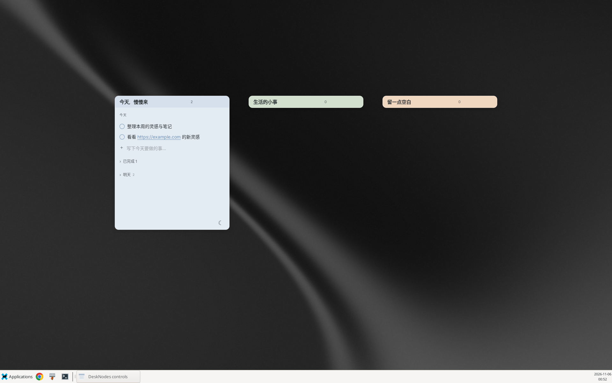
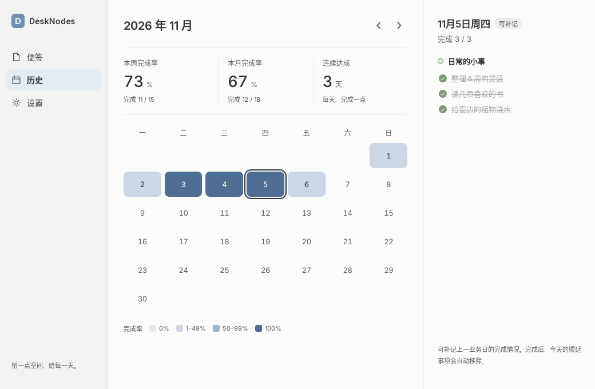
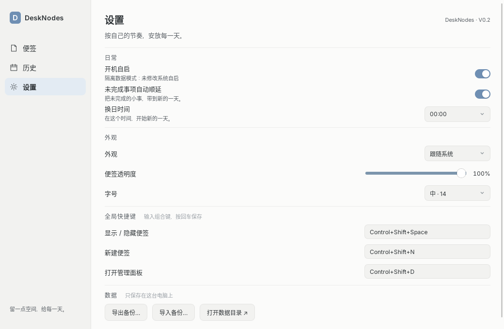
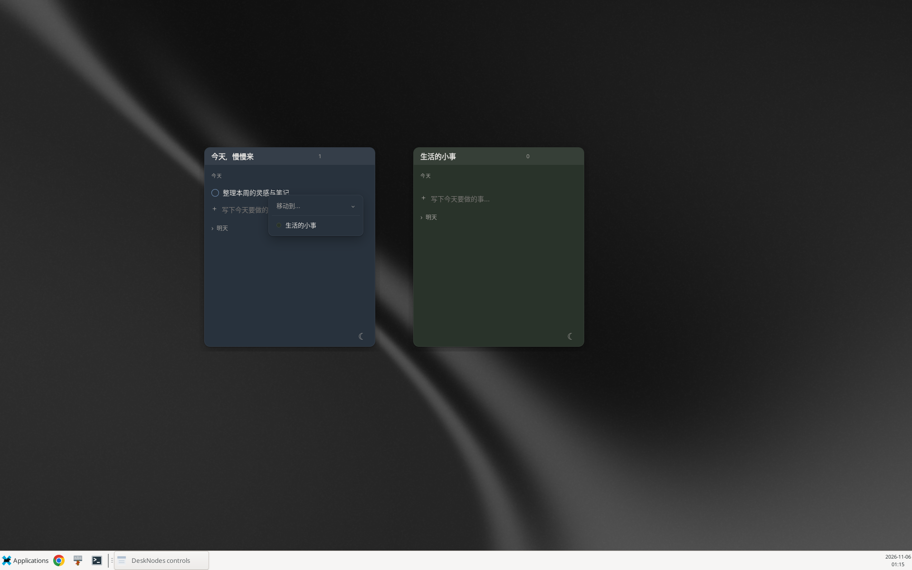

[English](README.md) · [简体中文](README.zh-CN.md)

# DeskNodes

安静、柔和的桌面待办便签。DeskNodes V1.0 将独立便签窗口、本地事项存储、明日计划与历史日历结合起来，为每天留一点空间。本文依据源码版本 `e415d2f` 编写；npm、Cargo 与 Tauri 的打包版本均为 **1.0.0**。



## V1.0 功能

- 独立窗口、八种莫兰迪配色、标题编辑、置顶、隐藏、拖动与缩放。位置、尺寸、可见性与折叠状态持久保存；折叠/展开遵循系统减少动态效果设置。
- 今天与明天的事项：新增、编辑、完成、删除，拖动排序今天的未完成事项，通过右键菜单移动到另一张便签。删除和移动提供五秒撤销；HTTP/HTTPS 链接使用系统浏览器打开。
- 可选择本地时间 00:00–06:00 换日；可自动顺延未完成事项，并显示累计顺延天数。明天的计划在换日后成为今天的事项；系统时间回拨不会使已保存的业务日期倒退。
- 管理面板可控制便签显隐和置顶；历史日历提供每日详情、周/月完成率和连续达成天数。上一业务日可补记完成情况，更早日期只读；补记为完成时会移除今天对应的未完成顺延副本。
- 跟随系统/浅色/深色外观、70–100% 便签透明度、三档字号、可配置全局快捷键、登录自启、JSON 备份导入导出，以及打开数据目录。
- 托盘操作、备用原生控制窗口和单实例处理：再次启动会打开管理面板。显示器配置变化后重新约束窗口位置，帮助找回离开可用工作区的便签。

数据保存在本机 SQLite 数据库中；没有云同步或账号流程。当前应用界面为中文。

## 界面预览

以下为已有 Linux X11 截图，使用演示数据及模拟日期；它们用于展示功能，并非本次文档修改时重新拍摄。

| 历史与统计 | 设置 |
| --- | --- |
|  |  |



当前源码及截图中的设置页仍显示旧的 **V0.2** 标签；实际打包元数据版本为 **1.0.0**。

## 平台验证状态

| 平台 | 已验证范围 |
| --- | --- |
| Debian 13 Linux，x86_64，X11 | 已测试；已有验证涵盖原生交互、deb 打包和解包后的 AppImage 启动。干净系统安装验收仍待完成。 |
| macOS | 仅通过使用 Darwin C 桩的 Rust 跨目标编译检查；未完成原生运行、DMG 验收、签名或公证。 |
| Windows | 仅通过 Windows GNU Rust 跨目标编译检查；未完成原生运行、MSI/NSIS 验收或签名。 |

参见 [Linux 验证记录](docs/f10-validation.md)与[发布验收清单](docs/f10-release.md)。这些是历史记录，不代表本次文档编辑重新执行了所有检查。Wayland、真实多显示器与混合 DPI 验收仍未完成。

## 开发与构建

请在对应的原生操作系统上构建完整分支 `cursor/v1.0-desknodes`。以下各节是独立流程，选择自己的系统即可；除非另有说明，命令均在仓库根目录执行。这些说明不代表 macOS 或 Windows 已通过运行验收，参见上方平台状态。

仓库中的 [.cargo/config.toml](.cargo/config.toml) 将构建并发设为 2，并为原开发环境硬编码了 `target-dir = "/workspace/desknotes/target"`。你的机器**不需要该路径**：各节均通过环境变量覆盖为克隆目录内绝对、可写的 `target` 目录。每次打开新终端，执行原生命令前都要重新设置该变量。下列路径按原生宿主架构、不传 `--target` 参数的情况编写。

`npm run dev` **仅启动 Vite 前端**（端口 1420）；`npm run build` 仅执行 Svelte/TypeScript 检查及前端资源构建。需要原生功能时，用 `npm run tauri dev` 开发，或用 `npm run tauri build -- ...` 构建原生生产版本；Tauri 会自动调用对应的前端脚本。构建或启动另一份应用前，先用 Ctrl+C 停止开发进程。

### macOS（终端）

1. 安装 Git（Xcode Command Line Tools 自带）和 Apple 桌面构建工具，完成安装对话框：

   ```sh
   xcode-select --install
   ```

2. 从 [Node.js 官方下载页](https://nodejs.org/en/download) 选择 24 版本及对应 CPU 架构，使用 macOS `.pkg` 安装 **Node.js 24.x 和 npm**。通过 [官方 rustup](https://rust-lang.org/tools/install/) 安装 Rust，并选择支持 edition 2024 的当前 stable：

   ```sh
   curl --proto '=https' --tlsv1.2 -sSf https://sh.rustup.rs | sh -s -- -y --default-toolchain stable
   . "$HOME/.cargo/env"
   rustup update stable
   rustup default stable
   node --version
   npm --version
   rustc --version
   ```

   若 PATH 尚未包含 Node，请重新打开终端。参见 [Tauri 官方前置依赖](https://v2.tauri.app/start/prerequisites/#macos)。配置中的 macOS 最低版本为 10.15；所选工具链和系统 WebView 的兼容性仍需原生验证。

3. 在已登录的桌面会话中克隆、安装锁定依赖、覆盖 Cargo 产物目录并启动原生开发：

   ```sh
   git clone --branch cursor/v1.0-desknodes --single-branch https://github.com/zlYeYaBuFaYa/desk_nodes.git
   cd desk_nodes
   npm ci
   export CARGO_TARGET_DIR="$PWD/target"
   npm run tauri dev
   ```

4. 选择生产产物。**仅构建可执行文件**并启动：

   ```sh
   npm run tauri build -- --no-bundle
   "$CARGO_TARGET_DIR/release/desk-nodes"
   ```

   如需 **应用包及 DMG**，明确选择 macOS 目标：

   ```sh
   npm run tauri build -- --bundles app,dmg
   open "$CARGO_TARGET_DIR/release/bundle/macos/DeskNodes.app"
   ```

   应用位于 `target/release/bundle/macos/DeskNodes.app`，磁盘映像位于 `target/release/bundle/dmg/`。安装时在 Finder 中打开生成的 `.dmg`，将 **DeskNodes.app** 拖到 **Applications（应用程序）**，推出映像，再从应用程序启动 **DeskNodes**（或执行 `open /Applications/DeskNodes.app`）。产物文件名包含版本和架构，以实际构建结果为准。

   尚未配置或验收签名及公证。未签名/未公证的应用可能被 Gatekeeper 阻止；对于可信的自建产物，可在可用时使用 macOS **系统设置 → 隐私与安全性 → 仍要打开**。原生运行及 DMG 安装尚未验证；对外分发前需要签名、公证和原生验收。

### Windows（PowerShell，原生 MSVC）

1. 安装 [Git for Windows](https://git-scm.com/downloads/win)。安装 [Microsoft C++ Build Tools](https://visualstudio.microsoft.com/visual-cpp-build-tools/)，选择 **使用 C++ 的桌面开发**，包含对应架构的 MSVC 编译器和 Windows 10/11 SDK。确认已安装 [Microsoft Edge WebView2 Runtime](https://developer.microsoft.com/en-us/microsoft-edge/webview2/)；缺少时使用 Evergreen 安装程序。参照 [Tauri 官方 Windows 前置依赖](https://v2.tauri.app/start/prerequisites/#windows)。
2. 从 [Node.js 官方下载页](https://nodejs.org/en/download) 选择 24 版本及对应架构，使用 Windows `.msi` 安装 **Node.js 24.x 和 npm**。从 [Rust 官方下载页](https://rust-lang.org/tools/install/) 下载并运行对应的 Windows `rustup-init.exe`，使用 **MSVC** 宿主工具链。安装后重新打开 PowerShell。对于 **x64 Windows**，选择 stable MSVC 并验证：

   ```powershell
   rustup toolchain install stable-x86_64-pc-windows-msvc
   rustup default stable-x86_64-pc-windows-msvc
   node --version
   npm --version
   rustc -vV
   ```

   host 行应为 `x86_64-pc-windows-msvc`。原生 ARM64 Windows 请安装 ARM64 C++ 构建工具，并改用 `stable-aarch64-pc-windows-msvc`。原生发布构建使用 MSVC。若 PowerShell 阻止 `npm.ps1`，下列命令中的 `npm` 可替换为 `npm.cmd`。

3. 在 Windows 桌面会话中克隆并启动原生开发：

   ```powershell
   git clone --branch cursor/v1.0-desknodes --single-branch https://github.com/zlYeYaBuFaYa/desk_nodes.git
   cd desk_nodes
   npm ci
   $env:CARGO_TARGET_DIR = Join-Path $PWD 'target'
   npm run tauri dev
   ```

4. **仅构建生产可执行文件**并启动：

   ```powershell
   npm run tauri build -- --no-bundle
   & (Join-Path $env:CARGO_TARGET_DIR 'release\desk-nodes.exe')
   ```

   目标机器仍需安装 WebView2。生成**安装程序**时，明确选择 Windows 目标：

   ```powershell
   npm run tauri build -- --bundles msi,nsis
   Get-ChildItem (Join-Path $env:CARGO_TARGET_DIR 'release\bundle\msi\*.msi')
   Get-ChildItem (Join-Path $env:CARGO_TARGET_DIR 'release\bundle\nsis\*-setup.exe')
   ```

   MSI 位于 `target\release\bundle\msi\`，NSIS 安装程序位于 `target\release\bundle\nsis\`。双击其中**一个**生成的 `.msi` 或 `-setup.exe`，完成安装后从开始菜单启动 **DeskNodes**。文件名包含版本、架构，也可能包含语言，请选择实际生成的文件。Tauri 按需下载打包工具，首次打包需要网络。生成 MSI 还要求启用 Windows **VBScript** 可选功能，参见 [Tauri Windows 安装程序指南](https://v2.tauri.app/distribute/windows-installer/)。仅构建 NSIS 可用 `npm run tauri build -- --bundles nsis`。

   尚未配置 Windows 签名。SmartScreen 可能提示未知发布者或阻止未签名产物；仅对可信产物按本机策略继续操作。原生运行、MSI/NSIS 安装、自启和快捷键仍未验证。

### Debian 13 Linux（shell）

1. 根据 [Tauri 官方 Linux 前置依赖](https://v2.tauri.app/start/prerequisites/#linux) 安装原生编译器、GTK 3/WebKitGTK 4.1、托盘及打包依赖：

   ```sh
   sudo apt update
   sudo apt install git build-essential pkg-config curl wget file libssl-dev libxdo-dev \
     libwebkit2gtk-4.1-dev libgtk-3-dev libayatana-appindicator3-dev librsvg2-dev \
     patchelf xz-utils ca-certificates
   ```

2. 从 [Node.js 官方下载页](https://nodejs.org/en/download) 安装 **Node.js 24.x 和 npm**：选择 24 版本、Linux 及对应架构，下载 `.tar.xz` 二进制归档，解压到可写目录，并将其 `bin` 加入 PATH（同时写入 shell 配置以持久生效）。不要假定 Debian 默认的 `nodejs` 包就是 24 版本。例如，归档保存在 `~/Downloads` 时，请确保只匹配一个归档：

   ```sh
   mkdir -p "$HOME/.local/lib/nodejs/node24"
   tar -xJf "$HOME/Downloads/node-v24."*-linux-*.tar.xz \
     --strip-components=1 -C "$HOME/.local/lib/nodejs/node24"
   export PATH="$HOME/.local/lib/nodejs/node24/bin:$PATH"
   node --version
   npm --version
   ```

   通过 [官方 rustup](https://rust-lang.org/tools/install/) 安装支持 edition 2024 的当前 Rust stable：

   ```sh
   curl --proto '=https' --tlsv1.2 -sSf https://sh.rustup.rs | sh -s -- -y --default-toolchain stable
   . "$HOME/.cargo/env"
   rustup update stable
   rustup default stable
   rustc --version
   ```

3. 使用已登录的**图形桌面会话**及其实际显示和会话环境；无图形环境的 SSH shell 无法直接启动界面。已测试环境为 Debian 13 x86_64 X11，Wayland 尚未验收。克隆并启动：

   ```sh
   git clone --branch cursor/v1.0-desknodes --single-branch https://github.com/zlYeYaBuFaYa/desk_nodes.git
   cd desk_nodes
   npm ci
   export CARGO_TARGET_DIR="$PWD/target"
   npm run tauri dev
   ```

   在 X11 会话中，`GDK_BACKEND=x11 npm run tauri dev` 可明确选择 GTK 的 X11 后端。必要时将 `DISPLAY` 设置为实际会话显示编号，不要照抄固定编号。

4. **仅构建生产可执行文件**，在图形会话中启动：

   ```sh
   npm run tauri build -- --no-bundle
   "$CARGO_TARGET_DIR/release/desk-nodes"
   ```

   该可执行文件仍依赖系统 GTK/WebKitGTK 等运行库。生成 **deb 和 AppImage 安装包**时，选择 Linux 目标：

   ```sh
   npm run tauri build -- --bundles deb,appimage
   ls "$CARGO_TARGET_DIR/release/bundle/deb/"*.deb
   ls "$CARGO_TARGET_DIR/release/bundle/appimage/"*.AppImage
   ```

   x86_64、版本 1.0.0 的预期路径为 `target/release/bundle/deb/DeskNodes_1.0.0_amd64.deb` 和 `target/release/bundle/appimage/DeskNodes_1.0.0_amd64.AppImage`。安装 deb 并启动已安装的可执行文件：

   ```sh
   sudo apt install "$CARGO_TARGET_DIR/release/bundle/deb/DeskNodes_1.0.0_amd64.deb"
   desk-nodes
   ```

   也可不安装 deb，直接运行 AppImage：

   ```sh
   chmod +x "$CARGO_TARGET_DIR/release/bundle/appimage/DeskNodes_1.0.0_amd64.AppImage"
   "$CARGO_TARGET_DIR/release/bundle/appimage/DeskNodes_1.0.0_amd64.AppImage"
   ```

   请按实际产物调整版本和架构文件名。AppImage 可能需要 FUSE 2（Debian 13 可用 `sudo apt install libfuse2t64`）。没有 FUSE 时，可在可写目录解包后启动：

   ```sh
   "$CARGO_TARGET_DIR/release/bundle/appimage/DeskNodes_1.0.0_amd64.AppImage" --appimage-extract
   ./squashfs-root/AppRun
   ```

   Linux 安装包未签名。已有检查覆盖 deb 内容和解包后 AppImage 启动，但干净系统安装验收仍待完成。本文不声称存在已发布版本或下载服务。

## 日常操作与快捷键

首次创建数据库时，会生成一张便签和三条引导事项。双击标题重命名；颜色按钮打开调色板；图钉控制置顶；减号隐藏；更多菜单可折叠或删除。删除便签需要确认，采用软删除并保留事项与历史。允许删除最后一张便签；之后可从管理面板或托盘新建，不会重新填入示例。

按 Enter 添加事项或保存编辑，Escape 退出编辑、关闭菜单。焦点不在文本输入框内时，Delete/Backspace 可删除选中的今天事项。展开“已完成”查看已完成事项，展开“明天”安排明日计划。右键事项可选择“移动到…”其他便签。

| 全局操作 | Linux / Windows 默认值 | macOS 默认值 |
| --- | --- | --- |
| 显示/隐藏便签 | Ctrl+Shift+Space | Super（Command）+Shift+Space |
| 新建便签 | Ctrl+Shift+N | Super（Command）+Shift+N |
| 打开管理面板 | Ctrl+Shift+D | Super（Command）+Shift+D |

在设置中输入快捷键组合，按 Enter 或移出焦点保存。注册失败会显示错误并保留原绑定；桌面环境保留的组合可能无法使用。

临时隐藏全部会记录原先可见的便签，恢复时不会显示此前单独隐藏的便签。可通过托盘“显示全部”、管理面板显隐开关或全局切换快捷键找回。托盘宿主不可用时，原生控制窗口提供备用入口。关闭便签窗口只会隐藏；请通过托盘或控制菜单的退出项结束应用。自启默认开启，集成错误会在设置中显示。Linux 使用 `$XDG_CONFIG_HOME/autostart/DeskNodes.desktop`；该变量不存在或不是绝对路径时，使用 `~/.config/autostart/DeskNodes.desktop`。

历史完成率按完成事项总数除以事项总数计算，包含已删除便签保留的历史，排除未来日期。每周从周一到周日。连续达成要求每天至少一项且全部完成：今天已全部完成则从今天起算，否则从昨天起算；空白或未全部完成的日期会中断连续天数。周统计与连续天数基于当前业务日期，月统计随所浏览月份变化。

## 数据、备份与恢复

| 系统 | 产品数据目录 |
| --- | --- |
| Linux | 设置了 `$XDG_DATA_HOME` 时为 `$XDG_DATA_HOME/DeskNodes`，否则为 `~/.local/share/DeskNodes` |
| macOS | `~/Library/Application Support/DeskNodes` |
| Windows | 设置了 `%APPDATA%` 时为 `%APPDATA%\DeskNodes`，否则为 `%USERPROFILE%\AppData\Roaming\DeskNodes` |

`desknodes.sqlite3` 以 SQLite WAL 模式保存便签、按日期划分的事项及设置，可能同时存在 `-wal` 和 `-shm` 文件。`DESKNODES_DATA_DIR=/absolute/path` 会直接覆盖整个产品目录，不会再追加 `DeskNodes`。使用该覆盖项时，启动阶段不修改系统自启；在设置中主动切换自启仍会改变系统集成。正常启动可从旧的、以 Tauri 应用标识命名的数据目录迁移一次，保留旧文件，并且不会覆盖目标目录中已有的数据库。

自动快照在**需要换日时、实际换日前**创建，包含启动时补做的换日，存入数据目录中的 `backups/`。保留最新七个完整快照目录，有 SQLite 伴随文件时一起保存。这是换日保护，并非持续版本历史。

遇到 SQLite 数据库损坏或非数据库格式错误时，启动会尝试恢复最新快照，将损坏文件保留为带 `.damaged-<UUID>` 后缀的文件，并在便签内提示恢复成功。其他错误会直接返回；缺少备份或备份不可用可能导致启动失败。最新快照恢复失败后，不会继续寻找更早快照。

设置页可导出版本 1 的 JSON，包含全部便签、事项、历史及设置，也包含已删除便签。导入先在隔离数据库中验证，确认后以事务替换全部数据，并重启应用。建议先导出当前数据；取消操作不会替换数据。手动恢复文件前，应退出应用，完整保留数据目录及伴随文件，再进行替换。请在该目录之外另存独立 JSON 备份。

## 技术栈、目录与检查

Tauri 2 和 Rust 管理原生窗口、托盘、快捷键及系统集成；Svelte 5、TypeScript 6 与 Vite 8 构建界面；`svelte-dnd-action` 提供拖动排序；SQLite 通过 `rusqlite` 捆绑构建。

| 路径 | 用途 |
| --- | --- |
| [src/App.svelte](src/App.svelte) | 便签窗口及事项交互 |
| [src/Management.svelte](src/Management.svelte)、[src/Settings.svelte](src/Settings.svelte) | 管理、历史与偏好设置 |
| [src/styles](src/styles) | 应用样式与生成的设计令牌 |
| [src-tauri/src](src-tauri/src) | 原生命令、数据库、换日、历史、设置及存储 |
| [src-tauri/tauri.conf.json](src-tauri/tauri.conf.json) | 版本、安装包目标、图标与应用配置 |
| [scripts](scripts) | 设计令牌生成、跨目标检查及功能冒烟脚本 |
| [docs](docs) | 设计资料及历史功能/验证报告 |

```sh
npm run check
npm run build
cargo test --manifest-path src-tauri/Cargo.toml
cargo clippy --manifest-path src-tauri/Cargo.toml -- -D warnings
scripts/xcheck.sh
npm run tokens                             # 根据设计 JSON 重新生成令牌 CSS
```

`xcheck.sh` 需要 Windows GNU/macOS Rust 目标、含 windres 的 MinGW 工具，以及 `/workspace/aienv/darwin-stub` 下仅用于检查的 Darwin 桩（可用 `DARWIN_STUB_DIR` 覆盖）。它不会链接或生成可运行的 macOS 应用。原生 `scripts/smoke-f*.py` 检查是依赖特定 X11 环境的测试夹具：运行前请阅读脚本，其中使用固定路径/显示编号、测试数据库，以及 xdotool、wmctrl、ImageMagick 等桌面自动化工具；它们不是可移植的单元测试入口。

## 已知限制

- Wayland 全局快捷键、托盘及原生窗口定位尚未验收；已测试的桌面环境为 Debian 13 X11。
- 真实显示器拔插、主显示器切换和混合 DPI 布局仍需硬件验收。代码每三秒轮询显示器拓扑和工作区，并约束恢复窗口的位置，但这不代表全部硬件场景均已验证。
- macOS 与 Windows 仅做编译检查。原生安装、自启、快捷键、签名、公证及干净系统行为仍是发布前待办；Linux 未配置安装包签名。
- 界面为中文，设置页版本标签仍为旧值；没有内置云同步，自动备份仅保留七个换日快照。
